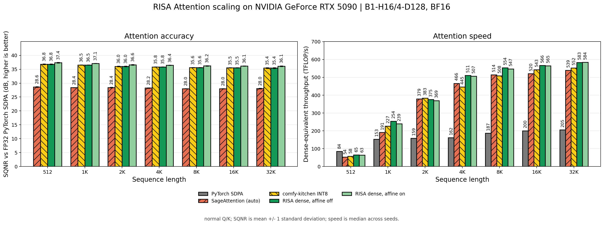
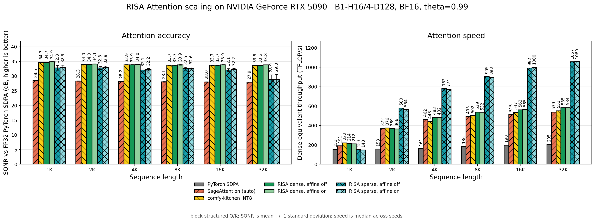

# RISA Attention

Rotation-stabilized INT8 attention for diffusion inference, with dense attention
and reusable retained-mass sparse patterns. Q/K/V use signed INT8, probabilities
use U8, and softmax and output accumulation use FP32.

## Installation

Requires Linux, Python 3.10+, CUDA-enabled PyTorch 2.4+, CUDA Toolkit 12.8+,
and an NVIDIA SM80+ GPU. Source builds use CMake 3.26+ and Ninja, installed
through pip's build dependencies.

Install CUDA-enabled PyTorch first, then run from the repository root:

```bash
python -m pip install .
```

By default, the build targets the GPU visible on the build host. To select an
explicit target, for example RTX 5090 (SM120):

```bash
CUDACXX=/usr/local/cuda/bin/nvcc \
CMAKE_ARGS="-DCMAKE_CUDA_ARCHITECTURES=120-real" \
python -m pip install .
```

## Usage

Inputs have logical shape `[batch, heads, tokens, channels]`, share a CUDA device
and FP16/BF16/FP32 dtype, and have a contiguous last dimension. Head dimensions
1–256, GQA/MQA and unequal Q/K lengths are supported. Query head count must be
divisible by KV head count. Output has the same shape and dtype as Q.

```python
import torch
import risa_attention as risa

q = torch.randn(1, 16, 4096, 128, device="cuda", dtype=torch.bfloat16)
k = torch.randn(1, 4, 4096, 128, device="cuda", dtype=q.dtype)
v = torch.randn_like(k)

output = risa.int8_attention(q, k, v)
```

The default scale is `channels ** -0.5`. Optional arguments include:

- `attn_mask`: boolean visibility (`True` allows attention) or additive bias,
  broadcastable to `[batch, query_heads, query_tokens, key_tokens]`.
- `is_causal=True`: upper-left causal attention.
- `v_quantization="midpoint_affine"`: residual-corrected affine V quantization;
  the default is symmetric `absmax`. Accuracy gains depend on the inputs and
  incur additional preparation cost.
- `return_lse=True`: returns `(output, lse)`, with FP32 natural-log normalizers.
  Fully masked rows have zero output and `-inf` LSE.

### Sparse reuse

Construct a pattern during a dense call, then reuse its selected key tiles on
later calls with compatible inputs:

```python
output, pattern = risa.construct_sparse_int8_attention(q, k, v, theta=0.99)

# On a later call, q, k and v contain the current inputs.
output = risa.sparse_int8_attention(q, k, v, pattern)
```

Patterns must match shape, scale, device, mask and causal setting. Each reuse
recomputes Q/K/V over frozen support. `theta` is a retained-mass target for each
128-token query block during construction; it is not a per-token or future-call
guarantee. Higher values retain more mass. Construction cost must be amortized
across reuse, and nearly dense patterns execute dense INT8 instead.

### Prequantized inputs

Separate preparation from execution when reusing the same Q/K/V:

```python
packed = risa.prequantize_int8_attention(q, k, v)
output = risa.int8_attention_from_prequantized(packed)
```

See [design](docs/design.md) for quantization details and output layouts.

## ComfyUI

Install the package with ComfyUI's Python interpreter and link the bundled node
into `custom_nodes`:

```bash
ln -s /path/to/RisaAttention/comfyui-risa-attention \
  /path/to/ComfyUI/custom_nodes/comfyui-risa-attention
```

Restart ComfyUI and connect the **RISA Attention** node's MODEL output to the
sampler. The node provides PyTorch, dense INT8 and sampling-scoped sparse modes.
See [ComfyUI integration](docs/comfyui.md) for compatibility and pattern lifetime.

## Benchmarks

Measured on RTX 5090 with PyTorch 2.13.0+cu130, CUDA 13.0 and BF16 on
October 10, 2026. Inputs use `B=1, Hq=16, Hkv=4, D=128` and HND storage.
Results aggregate seeds `0, 1, 2`: latency is the median of per-seed medians;
accuracy is the mean against FP32 PyTorch SDPA. Full-call latency includes
Q/K/V quantization. Affine off is `absmax`; affine on is `midpoint_affine`.

### Dense attention

Normal Q/K/V. Each table entry is **latency (ms) / NRMSE**; lower is better.
The figure shows SQNR (higher is better) and dense-equivalent throughput.



| Length | PyTorch SDPA | Sage2++ | comfy-kitchen | RISA affine off | RISA affine on |
| ---: | ---: | ---: | ---: | ---: | ---: |
| 512 | 0.025 / 0.0022 | 0.040 / 0.0370 | 0.037 / 0.0145 | 0.033 / 0.0145 | 0.034 / 0.0136 |
| 1K | 0.056 / 0.0022 | 0.045 / 0.0381 | 0.038 / 0.0149 | 0.034 / 0.0149 | 0.036 / 0.0140 |
| 2K | 0.217 / 0.0022 | 0.091 / 0.0380 | 0.090 / 0.0158 | 0.092 / 0.0158 | 0.093 / 0.0148 |
| 4K | 0.847 / 0.0023 | 0.295 / 0.0387 | 0.309 / 0.0161 | 0.269 / 0.0161 | 0.271 / 0.0151 |
| 8K | 2.946 / 0.0023 | 1.069 / 0.0397 | 1.082 / 0.0166 | 0.993 / 0.0166 | 1.005 / 0.0155 |
| 16K | 10.975 / 0.0023 | 4.228 / 0.0398 | 4.050 / 0.0168 | 3.883 / 0.0168 | 3.892 / 0.0156 |
| 32K | 42.858 / 0.0023 | 16.319 / 0.0396 | 15.929 / 0.0169 | 15.077 / 0.0169 | 15.063 / 0.0157 |

### Sparse reuse

Block-structured Q/K (`video_blocks`), normal V, `theta=0.99` and drift `0.05`.
Entries show **affine off / on**. Coverage is the selected key-tile fraction.
Construction produces a dense output; its cost is separate from later reuse.



| Length | Construction (ms) | Dense (ms) | Sparse (ms) | Coverage | Sparse SQNR (dB) |
| ---: | ---: | ---: | ---: | ---: | ---: |
| 1K | 0.176 / 0.170 | 0.040 / 0.040 | 0.056 / 0.058 | 52.3% | 32.82 / 32.92 |
| 2K | 0.219 / 0.217 | 0.093 / 0.094 | 0.059 / 0.061 | 50.0% | 32.79 / 32.93 |
| 4K | 0.485 / 0.484 | 0.284 / 0.285 | 0.176 / 0.178 | 51.4% | 32.09 / 32.21 |
| 8K | 1.432 / 1.416 | 1.020 / 1.034 | 0.608 / 0.612 | 50.1% | 32.54 / 32.65 |
| 16K | 4.904 / 4.908 | 3.909 / 3.894 | 2.217 / 2.199 | 51.7% | 32.10 / 32.21 |
| 32K | 19.125 / 19.115 | 15.046 / 15.053 | 8.319 / 8.302 | 50.3% | 28.89 / 28.95 |

At 32K, sparse reuse is about 1.81x faster than dense in this case. At 1K it
is slower, and construction must be amortized. Normal Q/K can retain nearly
all tiles and provide no sparse speedup. These synthetic tensor results do
not establish generated image or video quality.

See [benchmark protocol and reproduction commands](benchmarks/README.md),
including the [dense memory](benchmarks/figures/dense-memory-rtx5090.png) and
[sparse memory](benchmarks/figures/sparse-memory-rtx5090.png) plots.

## Development

See [tests](tests/README.md) for validation commands,
[contributing](CONTRIBUTING.md) for development builds, and
[design](docs/design.md) for implementation details and references.

## License

[Apache License 2.0](LICENSE). CUDA implementations derive from SageAttention,
comfy-kitchen and FlashInfer; sparse support follows the retained-mass approach
of LoSA. Derived files retain their copyright and license notices.
